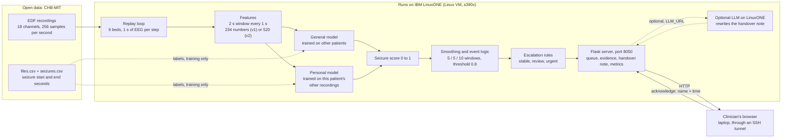

# How the EEG Review Queue works

For the IBM Z Datathon 2026 (theme: Real-Time AI for Critical Decisions). Written for a teammate and their AI coding assistant. Sections 1 to 5 take about 10 minutes and give you the whole picture. Sections 6 to 10 are reference: commands to copy, a file map and a list of things that do not line up yet.

> **Snapshot note.** This doc describes the code as it was on 2026-10-17 at about 13:55. Several files were still being edited while it was written (`src/engine.py`, `src/features.py`, `src/detector.py`, `src/experiments.py`, `scripts/download_chbmit.py`, `deploy/run_all.sh`, `scripts/scale_test.py`). Where the code and `README.md` or `CONTRACT.md` disagree, section 10 ("Known gaps") says so. When in doubt, trust the code.

---

## 1. What it does

When several patients are on brain monitoring (EEG), one specialist cannot watch every screen. The EEG Review Queue watches all of them at once. For each patient, a model reads the EEG as it streams in and spots suspected seizures while they happen. The queue then shows which patient needs a specialist now and why (stable, review or urgent), always puts urgent patients at the top, and opens the exact stretch of EEG that triggered the flag so the clinician can check it with their own eyes. The clinician acknowledges the alert (their name and the time are saved), and the system writes a handover note for the next person. It never suggests treatment, drugs or a diagnosis. It flags and shows evidence, and a human decides. The code runs on an IBM LinuxONE mainframe (a Linux server on IBM Z), and the demo replays real open recordings faster than real time.

**Two commands, if you only want to see it move (laptop):**

```bash
pip install flask
python app/server.py                  # fake beds, instant, no data needed
# open http://localhost:8050
```

### Rules of the road (for you and your AI assistant)

- `CONTRACT.md` is the agreement between the engine and the app. Do not change it without telling the lead.
- `data/` and `runs/` are git-ignored caches. Never commit EDF files, models or keys.
- If you change `src/features.py` or the model settings, delete `runs/features/`, `runs/models/` and `runs/train_rows_r30/` first. The caches are keyed by file name only, so stale results get reused silently. (The event logic and rules are not cached, so changing them needs no cleanup.)
- Say "suspected seizure" in the product. Never "seizure detected", never a diagnosis, never a treatment.
- Never share the SSH private key (`~/.ssh/linuxone_ibmz`). Section 6 explains how a teammate gets access instead.
- Start the live server with `OMP_NUM_THREADS=1`. Without it, scoring one window was tens of times slower in my test (section 10, gap 9).

---

## 2. INPUT: what goes in

### 2.1 What an EEG recording is

An EEG (electroencephalogram) is a recording of tiny voltage changes on the scalp. Electrodes are stuck on the head, and the machine measures the voltage over time. Each **channel** is the voltage difference between two electrodes. We use "bipolar" channels, so the name is the pair: `FP1-F7` means the voltage at electrode FP1 (front of the head, left) minus the voltage at F7 (left side, a bit further back).

Electrode letters follow the standard 10-20 layout: FP = front pole, F = front, C = centre, T = temple side, P = back-top, O = back of head, Z = midline. Odd numbers are the left side and even numbers are the right side.

The data is the **CHB-MIT Scalp EEG Database** from PhysioNet: recordings of children and young people with epilepsy, made at Boston Children's Hospital. It is open data (citation in `README.md`).

### 2.2 The recordings (EDF files)

- **Format:** EDF (European Data Format), a standard file type for body signals. We read it with the `mne` library (`mne.io.read_raw_edf`).
- **Sampling rate:** 256 samples per second, so one channel is a list of 256 numbers for every second.
- **Channels used:** 18 named bipolar channels, always in this order (`CHANNELS` in `src/features.py`):

| Group | Channels |
|---|---|
| Left temple chain | `FP1-F7`, `F7-T7`, `T7-P7`, `P7-O1` |
| Left top chain | `FP1-F3`, `F3-C3`, `C3-P3`, `P3-O1` |
| Right top chain | `FP2-F4`, `F4-C4`, `C4-P4`, `P4-O2` |
| Right temple chain | `FP2-F8`, `F8-T8`, `T8-P8`, `P8-O2` |
| Midline | `FZ-CZ`, `CZ-PZ` |

- **Extra channels:** the raw files carry up to 23. We pick our 18 by name and ignore the rest. Some recordings use a different electrode setup; `load_file()` in `src/detector.py` now builds the standard pairs from those too.
- **Units:** the file stores volts. We multiply by 1,000,000 to get microvolts.
- **Length:** most files are about 1 hour. In our current subset, patient `chb06` has files of about 4 hours. Size is roughly 40 to 50 MB per hour.
- **Where they live:** `data/chbmit/<case>/<file>.edf`, for example `data/chbmit/chb06/chb06_01.edf`. A "case" is one patient (`chb01` to `chb24`).

### 2.3 The summary files (where the seizure labels come from)

Each case has a text file from PhysioNet, `data/chbmit/<case>/<case>-summary.txt`. Doctors marked when each seizure started and ended. Real excerpt from `chb06-summary.txt`:

```
File Name: chb06_01.edf
File Start Time: 19:08:32
File End Time: 23:08:59
Number of Seizures in File: 3
Seizure 1 Start Time: 1724 seconds
Seizure 1 End Time: 1738 seconds
```

`scripts/download_chbmit.py` parses all 24 summary files and turns them into two CSV files.

### 2.4 The two data files we actually use

**`data/files.csv`** has one row per EDF file (all 24 cases, 676 rows):

| Column | Meaning |
|---|---|
| `case` | Patient id, e.g. `chb06` |
| `file` | EDF file name |
| `start_clock`, `end_clock` | Hospital clock time when the file starts and ends |
| `n_seizures` | How many seizures the doctors marked in that file |
| `downloaded` | `1` if the EDF is on disk, else `0` (the script re-checks the disk each run) |

Example row:

```
case,file,start_clock,end_clock,n_seizures,downloaded
chb06,chb06_01.edf,19:08:32,23:08:59,3,1
```

**`data/seizures.csv`** has one row per seizure (198 rows, matching PhysioNet's own count):

| Column | Meaning |
|---|---|
| `case`, `file` | Which recording |
| `start_s`, `end_s` | Seizure start and end, in seconds from the start of that file |

Example row (a 14-second seizure that starts 28 minutes 44 seconds into the file):

```
case,file,start_s,end_s
chb06,chb06_01.edf,1724,1738
```

Things that surprise people:

- Clock times can run past 24:00 (`chb06_02.edf` ends at `27:09:34`). The engine wraps them to a normal 24-hour clock.
- `chb24` has no clock times at all, so its beds count from `00:00:00`.
- Seizure labels are used to **train the models**, to **score the offline tests**, to pick where each demo bed starts replaying, and to compute the footer counters. Scoring a live window never looks at them.

### 2.5 How much data we have right now

By default `python scripts/download_chbmit.py` downloads the 5 cases with the most seizures that use the standard electrode setup: `chb06`, `chb12`, `chb15`, `chb16`, `chb24`. That is 56 files, 5 patients, 81 seizures, about 80.6 hours of EEG and 3.8 GB on disk. It always writes the CSVs for all 24 cases.

There is also a big mode, `FULL=1 python scripts/download_chbmit.py`, meant for the LinuxONE VM. It takes every seizure recording of every case plus 2 seizure-free ones per case, with a 40 GB and 3 hour cap. `deploy/run_all.sh` uses it.

---

## 3. PROCESSING: from raw voltage to a status

The same feature code runs in training and live, so the model sees identical inputs in both.

### Step 1: cut the recording into windows

- Window length: **2 seconds** (512 samples).
- Step: **1 second**, so each window overlaps the previous one by half.
- A 1-hour file gives 3,599 windows. Each window is stamped with its centre time.

In training, a window is labelled "seizure" (1) if its centre time falls between a seizure's `start_s` and `end_s`. Otherwise 0.

### Step 2: turn each window into numbers (features)

For every one of the 18 channels we compute **13 numbers**, so **18 x 13 = 234 features**. This is feature set **v1**.

| Per channel | Count | Plain meaning |
|---|---|---|
| Band power (log): delta 0.5 to 4 Hz, theta 4 to 8, alpha 8 to 13, beta 13 to 30, gamma 30 to 45 | 5 | How strong the brain wave is in each speed range. Delta is slow, gamma is fast. Log scale so loud values do not swamp everything. |
| Relative band power (same 5 bands) | 5 | The share of the total power that sits in each band. Describes the "shape" of the spectrum however loud the signal is. |
| Line length | 1 | How big the jumps between neighbouring samples are (log). A busy, jagged trace scores high. |
| Hjorth mobility | 1 | Roughly how fast the signal wiggles. |
| Hjorth complexity | 1 | How far the wiggle is from a clean sine wave. Close to 1 for a pure sine. |

Before the maths, each window has its average removed and gets a Hann taper, then an FFT gives the band powers (`windows_features()` in `src/features.py`).

**Feature set v2 (520 features)** adds context. This is what the live engine uses by default (`FSET=v2`):

- **Change vs this patient's own last 10 minutes:** for each of the 234 numbers, subtract the median of that number over the previous 600 windows. This only uses the past, so it works live, and it cancels out differences between patients. (In the latest code the baseline is refreshed every 30 seconds.) That adds 234 features.
- **Cross-channel summaries:** for each of the 13 number types, take the max and the mean across all 18 channels, for both the raw and the "change" version. This adds 4 x 13 = 52 features, so a seizure that starts in one spot looks similar wherever it is.

**Feature set v3 (624 features)** adds the cross-channel summaries from 2 and 4 seconds earlier. It is only used in experiments.

### Step 3: the models

Every model is the same kind: scikit-learn's `HistGradientBoostingClassifier` (many small decision trees, each one fixing the mistakes of the ones before it), with `max_iter=200`, `learning_rate=0.1`, `class_weight="balanced"`. It outputs a **seizure score from 0 to 1** for each window.

Seizures are rare, so training keeps **all** seizure windows and a **random sample of non-seizure windows** (up to 30,000 in `fit()`).

Two kinds of model exist:

- **General model:** trained on every other patient's recordings. It has never seen this patient.
- **Personal model:** trained on this patient's other recordings. It has never seen the recording being scored.

How they are combined depends on where you look (this is the most confusing part of the repo, so read carefully):

| Where | What it does |
|---|---|
| `python -m src.detector eval` (offline test, v1 features) | Scores every recording three ways: **general only** (leave one patient out), **personal only** (leave one recording out) and **combined** (the simple average of the two scores). Writes `runs/metrics.json`. This is the "hybrid multi-model" in `README.md`. |
| `python -m src.experiments v1 v2 v3` (offline experiments) | Compares feature sets and several modes: general, personal, **past** (the same patient's earlier recordings only, which is what a hospital really has), **hybrid** (general until the patient's first recorded seizure, then past) and, newest, **confirm** (the patient starts on the general model, and about a minute after each seizure ends, as if a clinician had confirmed it, a personal model is retrained on all of that patient's data up to that moment; general and personalised are then compared on the same stretches). Writes `runs/exp_<set>.json`. |
| `src/engine.py` (the live app) | **Personal-first, one model per bed.** It trains on the same patient's *earlier* recordings only. If there is no earlier recording with a seizure, it falls back to a general model trained on other patients. It does not average two models. The bed JSON carries a `model` label such as `personal (11 earlier recordings)` or `general (new patient)`. |

### Step 4: smooth the scores and build events (`EventTracker` in `src/rules.py`)

A single noisy window should not raise an alarm. So:

1. **Smooth:** take the average of the last **5** window scores (`SMOOTH_N = 5`). This is the `score_now` you see.
2. **Open an event:** when the smoothed score has been at or above the threshold for **5** windows in a row (`ON_COUNT = 5`). The threshold is **0.8** (`THRESHOLD` in `src/detector.py`, declared before looking at results). The event start is back-dated to the first of those 5 windows.
3. **Close an event:** when the smoothed score has stayed below the threshold for **10** windows in a row (`OFF_COUNT = 10`). The event end is the last second it was above the threshold.

Worked example (ran on the real code, threshold 0.8): scores of 0.95 from second 10 to 29 and 0.05 elsewhere. The alert opens at second 18, eight seconds after the burst began. The recorded event is 14 to 29, so 15 seconds. It stays "ongoing" until second 39, because it needs 10 quiet windows to close. Those numbers (5, 5, 10) are the "5 / 5 / 10" in the diagram.

### Step 5: escalation rules (`status_for()` in `src/rules.py`)

A clinician can edit these three numbers at the top of `src/rules.py`:

```python
URGENT_DURATION_S = 300        # one suspected seizure lasting 5+ minutes
URGENT_REPEAT_COUNT = 2        # or this many suspected seizures...
URGENT_REPEAT_WINDOW_S = 3600  # ...within this many seconds
```

| Condition (checked top to bottom) | Status | Reason text |
|---|---|---|
| No events | `stable` | `no suspected seizure activity` |
| Latest event lasted 300 s or more | `urgent` | `suspected seizure 6 min 10 s, still ongoing` |
| 2 or more events started within 3,600 s before the latest event's end | `urgent` | `2 suspected seizures within 60 min` |
| Anything else (at least one event) | `review` | `suspected seizure 15 s, ended` |

"Duration" is `end_s - start_s`. Urgent beds are always shown first and are never hidden.

### Step 6: the live replay (`src/engine.py`)

The engine replays real recordings for **6 beds** at once. Each tick it moves every bed forward by 1 second of recording, builds the features for the last 2 seconds, scores them, updates the event tracker and applies the rules.

- **Speed:** `SPEED` environment variable, default **10**, so one tick every 0.1 s and 10x real time. If the beds cannot all be scored in 0.1 s, the replay simply runs slower than 10x.
- **Which recordings:** each patient's *last* seizure recording, plus one seizure-free recording as a quiet control bed. With the current data that gives:

| Bed | Patient | Recording | Marked seizures (start to end, seconds into file) |
|---|---|---|---|
| 1 | chb06 | `chb06_24.edf` | 9387 to 9403 |
| 2 | chb12 | `chb12_42.edf` | 699 to 750, 945 to 973, 1170 to 1199, 1676 to 1701, 2213 to 2236 |
| 3 | chb15 | `chb15_62.edf` | 751 to 859 |
| 4 | chb16 | `chb16_17.edf` | 227 to 236, 1694 to 1700, 2162 to 2170, 3290 to 3298 |
| 5 | chb24 | `chb24_21.edf` | 2804 to 2872 |
| 6 | chb06 | `chb06_03.edf` | none (quiet bed) |

- **Staggered start:** bed *i* starts `60 + 90 x (i - 1)` seconds before its first marked seizure, so alerts do not all land together. The quiet bed has no seizure, so the code uses 900 s as a stand-in and it starts at 390 s.
- **Warm-up:** the v1 features of the 11 minutes before the start point are pre-loaded so the "change vs last 10 minutes" baseline is ready from the first second.
- **Alert clock:** when a new event opens, `alert_raised_at` is set to the replay clock and any earlier acknowledgement is cleared.
- **What can reach urgent here:** no marked seizure in our 56 files lasts 300 s or more (the longest is 205 s). So in this demo "urgent" comes from the "2 within an hour" rule: beds 2 and 4 are the ones that can get there. Beds 1, 3 and 5 reach "review" at most, unless the model raises a false alert.

### Offline test results (v1 features, `python -m src.detector eval`)

Event-level and honest: the general model never sees the test patient, the personal model never sees the test recording. Totals over 56 recordings, 80.6 hours, 81 marked seizures, at the declared threshold 0.8 (from `runs/metrics.json`):

| Model | Seizures caught | False alerts per 24 h | Median delay |
|---|---|---|---|
| General only | 31 of 81 (38%) | 296.0 | 8 s |
| Personal only | 70 of 81 (86%) | 0.6 | 6 s |
| Combined (average) | 33 of 81 (41%) | 0.0 | 7 s |

How the columns are counted: a seizure is "caught" if any event overlaps it. A "false alert" is an event that is not within 60 s before or 120 s after any marked seizure. "Delay" is the event start minus the seizure start. The file also holds a sweep over thresholds 0.5, 0.6, 0.7, 0.8, 0.9 and 0.95. For example, combined at 0.5 catches 59 of 81 (73%) with 70.9 false alerts per 24 h. These numbers are for the *offline v1 test*. The live app uses a different model setup (see section 10, gap 1).

---

## 4. OUTPUT: what comes out

The engine implements the interface in `CONTRACT.md`:

```python
class Engine:
    def start(self) -> None            # begin replaying all beds in a background thread
    def get_beds(self) -> list[dict]   # one dict per bed
    def get_evidence(self, bed) -> dict
    def ack(self, bed, who) -> dict    # returns the updated bed dict
    def handover(self, bed) -> str     # plain-text handover note
    def metrics(self) -> dict          # live counters for the footer
```

`app/mock_engine.py` fakes the same interface, so the screen can be built without models or data.

### 4.1 Bed JSON (`GET /api/beds` returns a list of these)

Produced by the real `Engine._bed_dict()` code (the values are an illustrative test case, not a live run):

```json
{
  "bed": 2,
  "patient_id": "chb12",
  "status": "urgent",
  "reason": "2 suspected seizures within 60 min",
  "score_now": 0.912,
  "model": "personal (3 earlier recordings)",
  "events": [
    {"onset_clock": "23:12:17", "duration_s": 61, "peak_score": 0.947, "ongoing": false},
    {"onset_clock": "23:41:28", "duration_s": 36, "peak_score": 0.903, "ongoing": true}
  ],
  "alert_raised_at": "23:41:50",
  "acknowledged_by": null,
  "acknowledged_at": null,
  "replay_clock": "23:42:06",
  "evidence": {"file": "chb12_06.edf", "start_s": 3384, "end_s": 3504}
}
```

| Field | Meaning |
|---|---|
| `status` | `stable`, `review` or `urgent` (section 3, step 5) |
| `reason` | The sentence shown on the card |
| `score_now` | Smoothed seizure score, 0 to 1 |
| `model` | Which model is scoring this bed (extra field, not in `CONTRACT.md`, the screen ignores it) |
| `events` | Every suspected seizure so far. Clock time is the file's start clock plus the seconds into the file |
| `alert_raised_at` | Replay clock when the newest event opened |
| `acknowledged_by`, `acknowledged_at` | Who looked, and when. Reset to `null` whenever a new event opens |
| `replay_clock` | The recording's clock time at the current replay position |
| `evidence` | Which stretch of EEG to show: always 120 s, starting 30 s before the latest event begins (or the last 120 s if there is no event) |

Acknowledging does **not** change the status. It only records who looked.

### 4.2 Evidence JSON (`GET /api/evidence/<bed>`)

The EEG snippet the browser draws. Real shape from `Engine.get_evidence()`:

```json
{
  "bed": 2,
  "fs": 64,
  "channels": ["FP1-F7", "F7-T7", "T7-P7", "P7-O1", "FP2-F8", "F8-T8", "T8-P8", "P8-O2"],
  "t0_s": 3384,
  "data": [[1.2, -0.4, 0.9, "..."], ["...7 more channels..."]],
  "event_spans": [[3414.0, 3450.0]]
}
```

- 8 channels (the left and right temple chains), at most 120 s.
- `data` is downsampled from 256 Hz to 64 Hz by averaging groups of 4 samples, in microvolts rounded to 0.1. A full window is 8 lists of 7,680 numbers. It is cut off at the current replay time, so it can be shorter.
- `t0_s` and `event_spans` use the same clock: seconds from the start of the file. The browser shades the spans and labels them "Model flagged".

### 4.3 Handover note (`GET /api/handover/<bed>` returns `{"bed": 2, "note": "..."}`)

A plain-text template filled from the bed data. Real output of `Engine.handover()` for the bed above:

```
Bed 2, patient chb12 (CHB-MIT recording chb12_06.edf).
Status: URGENT. Reason: 2 suspected seizures within 60 min.
Suspected seizure 1: onset 23:12:17, 1 min 1 s, peak model score 0.947.
Suspected seizure 2: onset 23:41:28, 0 min 36 s, peak model score 0.903, ongoing.
Alert raised 23:41:50. Not yet acknowledged.
Evidence: chb12_06.edf, 3384-3504 s.
These are model-detected suspected events, not confirmed seizures. Flagged for clinician review.
```

Optional: set `LLM_URL` to an OpenAI-compatible chat endpoint (for example a model server running on LinuxONE) and `LLM_MODEL` to its model name. The engine then asks the model to rewrite the note in calm clinical English, keep every number, avoid any drug, dose or diagnosis, and end with "Flagged for clinician review." If the call fails (30 s timeout), the template is shown with a note saying the LLM was unavailable.

### 4.4 Live metrics (`GET /api/metrics`, shown in the footer)

Shape from `Engine.metrics()` (values illustrative):

```json
{"beds": 6, "alerts_raised": 7, "false_alerts": 1, "median_detection_delay_s": 6.0,
 "processing_ms_per_window": 2.25, "replay_speed": 10}
```

`false_alerts` counts events that overlap no marked seizure. `median_detection_delay_s` is event start minus seizure start. `processing_ms_per_window` is the mean time for features plus scoring of one window, over the last 200. `replay_speed` is the configured `SPEED`, not a measured value.

### 4.5 What the clinician sees on screen (`app/static/index.html`)

- **Top bar:** "EEG Review Queue", a badge "Running on IBM LinuxONE", the note "Decision support on replayed recordings. A clinician confirms every alert.", and a clock.
- **Left, the Review queue:** one card per bed, sorted urgent, then review, then stable (unacknowledged before acknowledged). Each card shows the bed number, patient id, a small score bar, a coloured status pill, the reason, "Alert 3 min 12 s ago" and either "Awaiting acknowledgement" or "Acknowledged by Dr X, 23:44:02". The header counts, for example "1 urgent, 2 review, 3 stable".
- **Right, the detail panel** for the selected bed (it follows the top of the queue until you click a bed):
  - bed, patient, status pill, reason;
  - a small table of the last two events: onset, duration, peak score, ongoing or ended;
  - the **EEG evidence viewer**: 8 stacked traces on a canvas, flagged spans shaded and labelled "Model flagged", zoom buttons (15, 30, 60, 120 s) and a slider to scroll;
  - **Acknowledge** (asks for your name, remembers it in the browser, disabled for stable beds) and **Handover note** (opens the note in a dialog).
- **Footer:** the live metrics from 4.4.
- The page polls `/api/beds` every 1 s, `/api/metrics` every 3 s, and refetches the evidence every 4 s while an event is ongoing.

HTTP endpoints (`app/server.py`, Flask, binds `0.0.0.0`, port 8050 or `PORT`):

| Method and path | What it does |
|---|---|
| `GET /` | The web page |
| `GET /api/beds` | All beds |
| `GET /api/evidence/<bed>` | EEG snippet |
| `POST /api/ack/<bed>` | Body `{"who": "Dr Name"}`. Returns the updated bed. Missing name gives 400 |
| `GET /api/handover/<bed>` | Handover note |
| `GET /api/metrics` | Footer counters |

An unknown bed number returns 404 with a JSON error.

---

## 5. The whole pipeline in one picture



Read the two model boxes with the table in section 3, step 3: the offline test averages both scores, while the live engine today uses one personal-first model per bed.

---

## 6. Getting it onto the IBM Z mainframe, from zero

### 6.1 The idea in plain words

- **LinuxONE Community Cloud** is an IBM service that gives us a normal **Linux virtual server** that runs on an IBM mainframe. Inside it feels like any Ubuntu machine.
- The mainframe CPU has a different instruction set, called **s390x** (laptops are x86-64 or ARM). It is also "big-endian", which means it stores numbers in the opposite byte order. Our Python code does not care. Pre-built compiled packages do (6.4).
- We reach the VM with **SSH**, a secure remote terminal. To prove who we are, we use a **key pair**: a *private key* file that stays on your laptop and a *public key* line that anyone may see. The VM keeps a list of allowed public keys in `~/.ssh/authorized_keys`.
- We copy files with **scp**, and run Python on the VM.
- The web app listens on port 8050 **on the VM**. We do not rely on opening that port to the world. Instead an **SSH tunnel** carries our laptop's `localhost:8050` to the VM's `localhost:8050`. You browse on your laptop, the code runs on the mainframe. (The server binds to all network interfaces, so if the VM's firewall allows port 8050 from outside, the app is also reachable that way. We have not checked.)

### 6.2 The real values

| Thing | Value |
|---|---|
| Login user | `linux1` |
| Host (IP) | `YOUR_LINUXONE_IP` |
| Private key file (on the laptop) | `~/.ssh/linuxone_ibmz` (the public half is `~/.ssh/linuxone_ibmz.pub`) |
| Port the app uses | `8050` |

**Never share, paste, email, screenshot or commit the private key.** On Mac or Linux, run `chmod 600 ~/.ssh/linuxone_ibmz` or ssh will refuse it. On Windows, use **Git Bash** for every command below (PowerShell does not understand `/tmp` or `~` the same way).

### 6.3 Getting a teammate access

The teammate makes their own key pair and sends only the **public** key:

```bash
# on the teammate's laptop
ssh-keygen -t ed25519 -f ~/.ssh/linuxone_ibmz -C "teammate-name"
cat ~/.ssh/linuxone_ibmz.pub        # send this ONE line (it ends in .pub). Never send the file without .pub
```

Someone who can already log in adds it to the VM:

```bash
export KEY=~/.ssh/linuxone_ibmz
export HOST=linux1@YOUR_LINUXONE_IP
ssh -i "$KEY" "$HOST" 'echo "PASTE_THE_PUBLIC_KEY_LINE_HERE" >> ~/.ssh/authorized_keys'
ssh -i "$KEY" "$HOST" 'tail -n 3 ~/.ssh/authorized_keys'    # check the new line is on its own line
```

### 6.4 Why we install numpy, scipy, pandas and scikit-learn from Ubuntu apt, not pip

- pip normally downloads **wheels**: pre-built packages for common CPUs. PyPI has **no s390x wheels** for numpy, scipy, pandas or scikit-learn.
- Without a wheel, pip tries to build from source. That needs a C and Fortran compiler plus build tools, takes a very long time, and the VM has no compiler set up for it.
- Ubuntu's own package repository (`apt`) ships the same libraries already built for s390x (`python3-numpy`, `python3-scipy`, `python3-pandas`, `python3-sklearn`). So `deploy/setup.sh` installs them with `apt`.
- It then makes a virtual environment with `python3 -m venv --system-site-packages .venv`. That gives us a private Python that can still see the apt packages.
- `mne` is pure Python, so pip can install it. `setup.sh` runs `pip install mne lazy_loader`. See section 10, gap 7 about `--no-deps`.
- Because the apt versions differ from a laptop's, and the CPU byte order differs, **never copy `runs/models/` or `runs/train_rows_r30/` between your laptop and the VM**. Each machine trains its own. (`tar --exclude=runs` already does this.)

### 6.5 Copy-paste commands

Set these once in each terminal:

```bash
export KEY=~/.ssh/linuxone_ibmz
export HOST=linux1@YOUR_LINUXONE_IP
```

**0. Test the login.** The first time it asks to trust the host, type `yes`.

```bash
ssh -i "$KEY" "$HOST"
uname -m          # should print: s390x
exit
```

**1. Copy the code.** Run it from inside the project folder on your laptop. The folder must be called `eeg-review-queue`. Data and runs are left out because they are big and get rebuilt on the VM.

```bash
tar --exclude=data --exclude=runs --exclude=.git --exclude=.venv --exclude=__pycache__ \
    -czf /tmp/eeg.tgz -C .. eeg-review-queue
scp -i "$KEY" /tmp/eeg.tgz "$HOST":~
```

**2. Run setup (first time only).** It uses `sudo apt-get`, so it takes a few minutes. It ends with `all imports ok`, `features ok (9, 234) ...` and `rules ok ...`. Do not re-run it later unless dependencies changed, because it deletes and recreates `.venv`.

```bash
ssh -i "$KEY" "$HOST" 'tar xzf eeg.tgz && cd eeg-review-queue && bash deploy/setup.sh'
```

**3. Download the data on the VM** (faster than uploading from a laptop) **and run the evaluation.** Check disk space first. The small subset needs about 4 GB.

```bash
ssh -i "$KEY" "$HOST" 'cd eeg-review-queue && df -h . && mkdir -p runs && .venv/bin/python scripts/download_chbmit.py'
ssh -i "$KEY" "$HOST" 'cd eeg-review-queue && .venv/bin/python -m src.detector eval | tee runs/eval_linuxone.txt'
```

The download is safe to re-run; finished files are skipped. If your connection might drop, run long jobs in the background and check the log:

```bash
ssh -i "$KEY" "$HOST" 'cd eeg-review-queue && nohup .venv/bin/python -u scripts/download_chbmit.py > runs/download.log 2>&1 < /dev/null &'
ssh -i "$KEY" "$HOST" 'tail -n 5 eeg-review-queue/runs/download.log'
```

For the big run (all cases, experiments, scale test) use `deploy/run_all.sh`. It downloads with `FULL=1`, which can use up to 40 GB, so check `df -h` first. It writes timings and proof (`uname`, `lscpu`, RAM, versions) to `runs/proof_linuxone.txt`. Start it in the background, with `runs/` created first so the log file can open:

```bash
ssh -i "$KEY" "$HOST" 'cd eeg-review-queue && mkdir -p runs && nohup bash deploy/run_all.sh > runs/run_all.log 2>&1 < /dev/null &'
ssh -i "$KEY" "$HOST" 'tail -n 5 eeg-review-queue/runs/run_all.log'
```

**4. Start the app on the VM.** The first start trains the 6 bed models before the port opens, so give it a few minutes (it is much faster once step 3 has cached the features).

```bash
ssh -i "$KEY" "$HOST" 'cd eeg-review-queue && OMP_NUM_THREADS=1 nohup .venv/bin/python -u app/server.py --real > runs/server.log 2>&1 < /dev/null &'
ssh -i "$KEY" "$HOST" 'tail -n 5 eeg-review-queue/runs/server.log; curl -s localhost:8050/api/metrics'
```

When the log shows `EEG Review Queue (real engine) on http://localhost:8050` and `curl` prints JSON, the server is up. For a quick check without models, use `app/server.py` with no `--real`.

**5. Open the tunnel and browse.** Leave this window open. `-N` means "no shell, just forward".

```bash
ssh -i "$KEY" -N -L 8050:localhost:8050 "$HOST"
```

Then open **http://localhost:8050** on your laptop. If your laptop already uses port 8050 (for example a local server), use `-L 8051:localhost:8050` and open `http://localhost:8051`.

**6. Proof screenshots for the video.** Show `s390x` and the running server in one frame.

```bash
ssh -i "$KEY" "$HOST"
uname -m                         # s390x
lscpu | head -15
head -3 /etc/os-release
ps aux | grep "[s]erver.py"
tail -5 eeg-review-queue/runs/eval_linuxone.txt
```

Then screenshot the browser through the tunnel, with the footer showing the processing time per window.

**Update, restart, stop:**

```bash
# update code (no setup needed again): repeat step 1, then
ssh -i "$KEY" "$HOST" 'tar xzf eeg.tgz'
# restart
ssh -i "$KEY" "$HOST" 'pkill -f app/server.py'     # then run step 4 again
# changed features or model settings? clear the caches on the VM first
ssh -i "$KEY" "$HOST" 'rm -rf eeg-review-queue/runs/features eeg-review-queue/runs/models eeg-review-queue/runs/train_rows_r30'
```

What I changed compared with `deploy/linuxone.md`, so you are not surprised: added `mkdir -p runs` (the `tee` in step 3 needs the folder), excluded `.venv` and `__pycache__` from the tarball, added `OMP_NUM_THREADS=1`, added `-u` (so print output reaches the log) and `< /dev/null` (so `ssh` returns instead of hanging). I did not run these on the VM myself.

The VM has about 7.8 GB of RAM (stated in a comment in `src/experiments.py`). A 4-hour recording takes about 265 MB in memory, because the engine loads each bed's whole file.

---

## 7. Running it on your own machine (Windows or Mac)

```bash
pip install numpy scipy pandas scikit-learn joblib mne flask
python scripts/download_chbmit.py        # about 3.8 GB, a few minutes on the S3 mirror
python -m src.detector eval              # trains and tests, writes runs/metrics.json
python app/server.py                     # fake beds (needs Flask only)
python app/server.py --real              # real engine, replaying real recordings
```

Then open http://localhost:8050.

Quick self-tests (no data needed): `python -m src.features` and `python -m src.rules`.

Environment variables:

| Variable | Default | Effect |
|---|---|---|
| `PORT` | 8050 | Server port |
| `SPEED` | 10 | Replay speed (10 means 10x real time) |
| `FSET` | `v2` | Feature set the live engine uses: `v1`, `v2` or `v3` |
| `OMP_NUM_THREADS` | system | Set to `1` for the live server (section 10, gap 9) |
| `LLM_URL`, `LLM_MODEL` | unset | Optional handover rewrite via an OpenAI-compatible endpoint |
| `FULL` | unset | `FULL=1` makes the downloader fetch all cases |

How to set one: Mac and Git Bash `OMP_NUM_THREADS=1 python app/server.py --real`. PowerShell `$env:OMP_NUM_THREADS=1; python app/server.py --real`.

The first `--real` start builds the model cache in `runs/models/`, which takes a while. Later starts load it.

---

## 8. File map

| Path | What it does |
|---|---|
| `README.md` | Pitch, results table, run steps, data citations, limits |
| `CONTRACT.md` | The interface between engine and app (data files, `Engine` methods, JSON shapes) |
| `docs/HOW_IT_WORKS.md` | This file |
| `.gitignore` | Keeps `data/`, `runs/`, `.venv/`, `__pycache__/` out of git |
| `scripts/download_chbmit.py` | Downloads the CHB-MIT summaries and EDFs, writes `data/files.csv` and `data/seizures.csv`. `FULL=1` for all cases |
| `scripts/scale_test.py` | Streams N beds at once and times one scoring step (one-by-one vs one batched model call). Writes `runs/scale_test.json` |
| `src/features.py` | The 234 features per window, the v2/v3 context features (`augment`, `LiveFeatures`), channel picking |
| `src/rules.py` | The editable escalation numbers, `EventTracker` (smoothing and events), `status_for()` |
| `src/detector.py` | Data loading, feature cache, model training (`fit`), general and personal models, event-level scoring, and the `eval` command |
| `src/experiments.py` | Compares feature sets v1/v2/v3 and model modes (general, personal, past, hybrid). Writes `runs/exp_<set>.json` |
| `src/engine.py` | The live engine: replays 6 beds, scores each second, applies rules, serves bed, evidence, handover and metrics |
| `src/__init__.py` | Empty, makes `src` a package |
| `app/server.py` | Flask server and the six HTTP endpoints. `--real` picks `src/engine.py`, otherwise the mock |
| `app/mock_engine.py` | Fake engine with scripted beds and synthetic EEG, same interface |
| `app/static/index.html` | The whole screen: queue, detail, EEG canvas viewer, acknowledge, handover dialog, footer (plain HTML, CSS and JS) |
| `app/README.md` | Short app notes: endpoints, port |
| `deploy/linuxone.md` | The original LinuxONE steps (with placeholders). Section 6 here has the filled-in version |
| `deploy/setup.sh` | One-time VM setup: apt packages, venv, `pip install mne lazy_loader`, self-tests |
| `deploy/run_all.sh` | Long job on the VM: proof file, full download, features, experiments v2/v1/v3, scale test |
| `data/files.csv`, `data/seizures.csv` | The two data tables from section 2.4 (git-ignored, written by the downloader) |
| `data/chbmit/<case>/` | EDF files and `<case>-summary.txt` per patient (git-ignored) |
| `runs/features/*.npz` | Cached v1 features per recording (git-ignored) |
| `runs/models/*.joblib` | Cached trained models per bed recording. Old files without a prefix are from an earlier engine and are unused; current ones start with `v1_`, `v2_` or `v3_` (git-ignored) |
| `runs/train_rows_r30/<set>/*.npz` | Cached training samples per recording for the experiments (`r30` = baseline refreshed every 30 s). An older `runs/train_rows/` folder may exist and is unused |
| `runs/metrics.json` | Offline test results from `src.detector eval` |
| `runs/scale_test.json` | Output of `scripts/scale_test.py` |
| `runs_eval_local.txt` | Saved printout of the local `eval` run (same numbers as `runs/metrics.json`) |
| `runs/eval_linuxone.txt`, `runs/server.log`, `runs/proof_linuxone.txt` | Created on the VM by the commands above |

---

## 9. Honest limits

From `README.md`, plus what we found while reading the code:

- CHB-MIT is children and young people with hard-to-treat epilepsy, recorded in hospital after their medication was withdrawn. Adults, other settings and other machines may behave differently.
- The flags are **suspected events for clinician review**, not confirmed diagnoses.
- Replay is accelerated for the demo. Real time would be 1x.
- Our subset is small: 5 patients and 81 marked seizures. The "general" model learns from only 4 other patients, so it is weak (38% caught with about 296 false alerts per 24 h). Do not read the offline numbers as a hospital-grade result.
- The "personal" results use the same patient's other recordings. In the offline `eval` those can come from before *or after* the test recording, which is friendlier than real life. The `past` mode in `src/experiments.py` is the stricter test.
- The reported detection delay is measured to the back-dated event start, so the real time until an alert appears is about 4 to 5 seconds longer (section 10, gap 10).
- Demo beds replay recordings of different patients on one screen. Real wards would need patient identity, privacy and audit controls that this project does not have.
- The system never suggests treatment. Keep it that way in every screen, note and slide.

---

## 10. Known gaps

Things I found that do not line up. None of them are fixed here. I only wrote this doc and did not touch any code.

1. **The live engine and the offline test use different models.** `README.md` and `src/detector.py` describe a general model plus a personal model with averaged scores, tested on v1 features (234). `src/engine.py` (last edited 13:49) now runs **one personal-first model per bed** on feature set **v2** (520 features), so the offline numbers in `runs/metrics.json` do not describe what the app runs. The code comment says v2 is the "winning feature set from src/experiments.py", but no experiment result file exists yet (at 13:55 `runs/experiments_local.txt` is empty and there is no `runs/exp_*.json`; `src/experiments.py` was still being edited and had just gained the `confirm` mode). Also, the models cached at 13:39 are `v1_*`, so whoever ran the engine used `FSET=v1`. Before the demo, decide which setup you describe, and re-run the matching test. The `confirm` idea (personalise after a clinician confirms a seizure) is only simulated in `src/experiments.py`. The live app has no "confirm" button and does not retrain.
2. **`README.md` results table is unfilled.** It still says "(filled from runs/metrics.json)". The numbers are in section 3 above.
3. **Averaging hurts at the declared threshold.** In the offline test at 0.8, "combined" catches 41% of seizures while "personal only" catches 86%. An average can never be higher than the better of its two inputs, so the weak general model pulls many true seizure scores under 0.8. The README headlines the hybrid, but the table above tells a different story.
4. **`CONTRACT.md` vs the code.**
   - The real bed dict has an extra `model` field that `CONTRACT.md` does not list (harmless, the screen ignores it).
   - The real engine sends evidence with `fs: 64` (the rate of the data sent). The contract example and the mock say `fs: 256` (the recording rate) with 64 Hz data. The screen copes with both (`evRate()` in `index.html`).
   - The contract bed example shows an evidence window of 420 s. The contract text says at most 120 s, and the real engine always gives 120 s. The mock's `evidence.start_s`/`end_s` can span more than 120 s, although the data it sends is capped at 120 s.
   - `CONTRACT.md` does not define the `metrics()` keys. The real engine returns six (`beds`, `alerts_raised`, `false_alerts`, `median_detection_delay_s`, `processing_ms_per_window`, `replay_speed`). The mock returns four.
5. **Mock and real behave differently.** The mock drops events after an hour, so its beds go back to `stable`. The real engine never removes events, so a bed that left `stable` stays at `review` or `urgent` for the rest of the replay. Acknowledging changes nothing about status in either.
6. **The "Running on IBM LinuxONE" badge is fixed text.** It shows on a laptop and with the mock too. Prove LinuxONE with the terminal screenshots in step 6, not with the badge.
7. **`deploy/setup.sh` does not use `pip --no-deps`.** It runs `pip install -q mne lazy_loader`. This works only because the apt packages already satisfy mne's other dependencies, so pip has nothing heavy to build. If pip ever starts compiling numpy or scipy on the VM, add `--no-deps` and install the missing pure-Python pieces by hand.
8. **`deploy/linuxone.md` step 2 breaks on a fresh VM.** It pipes into `tee runs/eval_linuxone.txt`, but `runs/` does not exist yet because `runs` is excluded from the tarball. `tee` then cannot write the file. Section 6 adds `mkdir -p runs`. The file also still has `YOUR.VM.IP` placeholders.
9. **Speed trap with scikit-learn threads.** On my 16-core laptop, scoring one window took about 50 to 100 ms with default settings and about 0.6 to 2 ms with `OMP_NUM_THREADS=1` (other jobs were running, so treat it as a rough ratio). At 6 beds and `SPEED=10`, the budget is about 16 ms per bed, so the default can pull the replay well below 10x. The footer shows the *configured* speed, not the achieved one. I have not measured this on the VM. `runs/scale_test.json` currently holds only a 5-bed, 5-step smoke test from the laptop.
10. **Detection delay is understated by a few seconds.** The event start is back-dated 4 windows, and the alert only fires on the 5th. The offline and live delay numbers use the back-dated start.
11. **Bed 1 and bed 6 are both patient `chb06`.** The quiet control bed comes from the first case, so the queue shows the same patient id twice.
12. **What I did and did not run.** I started `app/server.py` (mock) on a spare port and checked the endpoints, the 400 and 404 errors, and that the page is served. I called the real `Engine` methods (`get_beds`, `get_evidence`, `handover`, `ack`, `metrics`) on a hand-built bed with random EEG, to produce the examples in section 4. I also ran `python -m src.features` and `python -m src.rules`, and timed model scoring on the laptop. I did not start `--real` (it trains models and writes to `runs/`, which another engineer was using), and I did not connect to the VM.
13. **`app/` status.** `server.py`, `mock_engine.py`, `static/index.html` and `README.md` all exist and work with the mock. Nothing in `app/` looks unfinished. The real-engine path depends on the files in gap 1 settling.
14. **Moving target.** While this doc was being written, `scripts/download_chbmit.py` gained `FULL=1`, `deploy/run_all.sh` and `scripts/scale_test.py` appeared, `src/detector.py` gained same-patient handling (`chb21` counts as `chb01`) and referential-montage support, `src/features.py` and `src/engine.py` changed their baseline handling, and `src/experiments.py` gained the `confirm` mode and a new cache folder (`runs/train_rows_r30/`). Re-check the file map and section 3 after the next round of edits.
