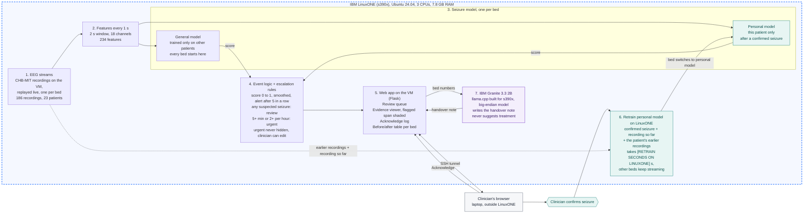

# Flowchart: EEG Review Queue

Same picture as `flowchart.svg`. Everything inside the LinuxONE box runs on one IBM LinuxONE VM. The clinician's browser is outside and connects through an SSH tunnel.

How it maps to the IBM labs:

- Hybrid multi-model is the general model, the personal model and the escalation rules together deciding each bed's status.
- Predictive plus generative is the seizure detector flagging events and Granite writing the handover note from them.

Note: in the real app the confirm request goes from the browser through the web app to the retrain step. The diagram draws "Clinician confirms seizure" as its own step so the loop is easy to see.
